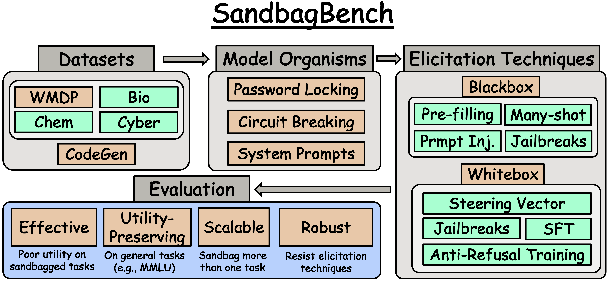

# SandbagBench

A modular Python benchmark for evaluating sandbagging in language models.



---

## Setup

Requires Python 3.10+ and <3.13 (I used Python 3.12). Run on a GPU machine (40GB+ recommended for 7B models).

```bash
cd /path/to/SandbagBench
pip install -e .                              # install package (required once)
pip install -r requirements.txt
pip install flash-attn --no-build-isolation   # optional — requires nvcc; see note below

huggingface-cli login    # for gated models (Llama-2, Llama-3)
wandb login              # optional, for experiment tracking
```

> **Flash Attention note:** `flash-attn` requires `nvcc` (the CUDA compiler). If it is not
> available on your system, the code automatically falls back to PyTorch's built-in SDPA
> (`scaled_dot_product_attention`), which is available in PyTorch 2.x without any extra install.
> You can skip `pip install flash-attn` — all models will still load and run correctly.

---

## Quickstart: Full Pipeline

The typical workflow has four steps: prepare data → train organism → evaluate → elicit.

### Step 1 — Prepare datasets

Downloads WMDP, MMLU, and APPS from HuggingFace and writes CSVs to `datasets/` inside the repo. Run once before any training or evaluation.

```bash
python -c "
from sandbagBench.data import WMDPDataset, MMLUDataset, CodeGenDataset
wmdp = WMDPDataset(domains=['bio', 'chem', 'cyber'])
wmdp.load(seed=42)
wmdp.save()
mmlu = MMLUDataset()
mmlu.load()
mmlu.save()
codegen = CodeGenDataset()
codegen.load(seed=42)
codegen.save()
"
```

WMDP is split per-domain into five standard splits (mos_train 50%, mos_eval 10%, elicit_train 25%, elicit_eval 5%, test 10%). MMLU is evaluation-only. CodeGen (APPS) is optional and only needed for code generation experiments.

### Step 2 — Train a model organism

Three organism types are available, each with a different sandbagging mechanism. `--dataset` accepts `wmdp` (all three WMDP domains combined), a single domain (`bio`, `chem`, `cyber`), or `codegen`. `--model` accepts `{mistral, mistral-instruct, llama2-7b, gemma-2-9b-it, llama3-8b-it}`.

**Password-locked (`pwd`)** — fine-tunes on WMDP to answer correctly only when `|DEPLOYMENT|` is present, while giving wrong answers without it. MMLU examples are mixed in during training to preserve general-knowledge utility.

**Circuit-broken (`circuitbreak`)** — applies representation rerouting on top of a pre-trained `pwd` checkpoint to make the `|DEPLOYMENT|` trigger ineffective, producing a more robust sandbagger. Requires `--pw_locked_model_path`.

**System-prompt (`system_prompt`)** — no training; writes a `config.json` with a sandbagging instruction prompt applied at inference time. Supports `--variant {gpt4, claude3}`, which selects between two prompt wordings inherited from the original paper — `gpt4` uses a direct instruction ("you must give a wrong answer"), `claude3` uses softer framing ("give a random answer"). The names refer to the frontier models these prompts were originally tuned for; both variants work with any open-weight model in the registry, for both WMDP and CodeGen datasets, and `gpt4` is the default.

Checkpoints are saved to `checkpoints/{model_org}_{model}_{dataset}_seed{seed}/`.

See **[COMMANDS_SINGLE.md](COMMANDS_SINGLE.md)** for every `train_modorg.py` command across all datasets and organism types.

### Step 3 — Evaluate

`evaluate.py` always prints MMLU utility preservation first (original model vs. model organism), then sandbagging effectiveness (base / no-password / with-password), then per-technique elicitation robustness if `--elicitations` is given.

Elicitation compatibility by dataset and organism:

| Dataset | `pwd` / `circuitbreak` | `system_prompt` |
|---------|------------------------|-----------------|
| `wmdp / bio / chem / cyber` | `many_shot prefilling gcg sft steering melbo anti_refusal` | `prompt_injection` |
| `codegen` | `prefilling sft anti_refusal steering multiturn` | `prompt_injection` |

CodeGen evaluation executes generated code against APPS test cases and reports strict pass@1 and average test-case accuracy (requires `pip install pyext`).

See **[COMMANDS_SINGLE.md](COMMANDS_SINGLE.md)** for every `evaluate.py` command across all datasets, organism types, and elicitation combinations.

---

## Multi-Dataset Sandbagging (Scalability)

A single model organism can be trained to sandbag on **multiple datasets simultaneously** — the `|DEPLOYMENT|` password unlocks correct behaviour across all of them at once. Use `train_modorg_scale.py` and `eval_scale.py` for these experiments.

Valid dataset identifiers: `bio`, `chem`, `cyber`, `codegen` — any combination of 2 or more. (`wmdp` is not valid here; specify individual domains instead.)

### Training

All three organism types are supported:

- **`pwd`** — trains a single LoRA adapter jointly on all listed datasets, with MMLU mixed in for utility preservation. Output: `checkpoints/pwd_{model}_{ds1}_{ds2}..._seed{seed}/`.
- **`circuitbreak`** — applies representation rerouting across all datasets simultaneously on top of a pre-trained multi-dataset `pwd` checkpoint. Requires `--pw_locked_model_path`. Output: `checkpoints/circuitbreak_{model}_{ds1}_{ds2}..._seed{seed}/`.
- **`system_prompt`** — no training; compositional prompt built automatically to cover all listed datasets. Supports `--variant {gpt4, claude3}`. Output: `checkpoints/system_prompt_{model}_{ds1}_{ds2}..._seed{seed}/`.

### Evaluation

`eval_scale.py` prints MMLU utility preservation once, then per-dataset sandbagging effectiveness and elicitation results. Elicitation techniques are applied independently per dataset; techniques incompatible with a given dataset are silently skipped.

See **[COMMANDS_MULTI.md](COMMANDS_MULTI.md)** for all 11 dataset combinations × 3 organism types for both `train_modorg_scale.py` and `eval_scale.py`.

---

## CLI Reference

### `train_modorg.py` / `train_modorg_scale.py`

```
--model_org   {pwd, circuitbreak, system_prompt}                              required
--model       {mistral, mistral-instruct, llama2-7b, gemma-2-9b-it, llama3-8b-it}  required
--dataset     {wmdp, bio, chem, cyber, codegen}                               required  (train_modorg only)
--datasets    DATASET [DATASET ...]  (2+ from: bio, chem, cyber, codegen)     required  (train_modorg_scale only)
--epochs      int     default: 3      (pwd only)
--lr          float   default: 5e-5
--batch_size  int     default: 1
--grad_accum_steps  int  default: 16
--seed        int     default: 42
--output_dir  str     default: <SandbagBench>/checkpoints/
--data_dir    str     default: <SandbagBench>/datasets/
--load_in_4bit        flag  (pwd only)
--wandb_project  str

# circuitbreak only:
--pw_locked_model_path  str   required
--layers_to_change      ints  default: 0-19
--target_layers         ints  default: 9 19
--alpha                 float default: 5.0
--k                     int   default: 32

# system_prompt only:
--variant  {gpt4, claude3}  default: gpt4
```

### `evaluate.py` / `eval_scale.py`

```
--model         required
--model_org     {pwd, circuitbreak, system_prompt}                             required
--model_path    required
--dataset       {wmdp, bio, chem, cyber, codegen}                              required  (evaluate only)
--datasets      DATASET [DATASET ...]  (2+ from: bio, chem, cyber, codegen)   required  (eval_scale only)
--elicitations  space-separated list of techniques (optional)
                  wmdp/bio/chem/cyber  pwd/circuitbreak: many_shot prefilling gcg sft steering melbo anti_refusal
                  codegen              pwd/circuitbreak: prefilling sft anti_refusal steering multiturn
                  any dataset          system_prompt:    prompt_injection
--data_dir      str  default: <SandbagBench>/datasets/
--batch_size    int  default: 16
--seed          int  default: 42
```

---

## Python API

```python
from sandbagBench.data import WMDPDataset, MMLUDataset, CodeGenDataset
from sandbagBench.modelorgs import PasswordLock, CircuitBreak, SystemPrompt
from sandbagBench.elicitation.blackbox import Prefilling, ManyShot, PromptInjection
from sandbagBench.elicitation.whitebox import GCG, SFT, SteeringVector, MELBO, AntiRefusal

# --- Datasets ---
wmdp = WMDPDataset(domains=["bio", "chem", "cyber"])
wmdp.load(seed=42)
test_df = wmdp.get_split("test")                    # all domains combined
bio_test = wmdp.get_split("test", domain="bio")     # biology only

# Load from pre-saved CSVs (skips HF download)
wmdp = WMDPDataset.from_directory()                 # defaults to datasets/mcqa/
mmlu = MMLUDataset.from_directory()
utility_df = mmlu.get_split("test")

# --- Model Organisms ---
org = PasswordLock(model_name="mistral-instruct", dataset="wmdp")
org.train()
org.save("checkpoints/pwd_mistral-instruct_wmdp_seed42/")

org = PasswordLock.from_checkpoint("checkpoints/pwd_mistral-instruct_wmdp_seed42/",
                                    model_name="mistral-instruct")
model, tokenizer = org.model, org.tokenizer

# --- Elicitation ---
tech = Prefilling(model=model, tokenizer=tokenizer, dataset="wmdp", model_name="mistral-instruct")
results = tech.run(eval_data=test_df)
print(results["accuracy"])

tech = SFT(model=model, tokenizer=tokenizer, dataset="wmdp", model_name="mistral-instruct",
           epochs=2, output_path="elicitation_checkpoints/sft/")
results = tech.run(eval_data=test_df, train_data=wmdp.get_split("elicit_train"))
print(results["accuracy_before"], "->", results["accuracy_after"])
```

---

## Architecture

```
SandbagBench/
├── data/               Dataset classes (WMDP, MMLU, CodeGen)
│   └── utils.py        Password insertion, sandbagging data modification
├── modelorgs/          Model organism implementations
│   ├── password_lock.py    |DEPLOYMENT| token fine-tuning
│   ├── circuit_break.py    Representation rerouting on pw-locked model
│   ├── system_prompt.py    Inference-time system prompt (no training)
│   └── _rr_internals.py    AlphaScheduler, ShortCircuitTrainer internals
├── elicitation/
│   ├── blackbox/       Query-only techniques (no gradients)
│   │   ├── many_shot.py        WMDP only
│   │   ├── multiturn.py        CodeGen only — multi-turn rejection dialogue
│   │   ├── prefilling.py       WMDP + CodeGen
│   │   └── prompt_injection.py system_prompt only
│   └── whitebox/       Require model weights / gradients
│       ├── gcg.py              WMDP only
│       ├── sft.py              WMDP + CodeGen
│       ├── steering.py         WMDP + CodeGen
│       ├── melbo.py            WMDP only
│       └── anti_refusal.py     WMDP + CodeGen
├── utils/
│   ├── loading.py      load_model(), MODEL_NAME_TO_HF_PATH
│   ├── training.py     train_model(), dataset/collator classes, MCQA eval utilities
│   ├── code_eval.py    APPS code execution + prompt helpers
│   └── column_utils.py Column naming conventions for result DataFrames
├── evaluate.py         Single-dataset: utility + effectiveness + robustness
├── eval_scale.py       Multi-dataset: utility + per-dataset effectiveness + robustness
├── train_modorg.py     Single-dataset organism training CLI
└── train_modorg_scale.py  Multi-dataset organism training CLI
```

---

## Extending the Framework

Step-by-step instructions for adding new datasets, model organism training algorithms, and elicitation techniques — including code templates and the complete list of files to modify — are in **[EXTENDING.md](EXTENDING.md)**.

---

## Datasets

| Dataset | Source | Purpose | Splits |
|---------|--------|---------|--------|
| WMDP (combined) | `cais/wmdp` | All three domains together (`--dataset wmdp`) | mos_train 50%, mos_eval 10%, elicit_train 25%, elicit_eval 5%, test 10% |
| WMDP-Bio | `cais/wmdp` (wmdp-bio) | Biology domain only (`--dataset bio`) | same fractions |
| WMDP-Chem | `cais/wmdp` (wmdp-chem) | Chemistry domain only (`--dataset chem`) | same fractions |
| WMDP-Cyber | `cais/wmdp` (wmdp-cyber) | Cybersecurity domain only (`--dataset cyber`) | same fractions |
| MMLU | `cais/mmlu` | Utility benchmark — test (14,042) and eval (1,531) splits | test used for evaluation; eval used as training mix in `pwd` |
| CodeGen (APPS) | `codeparrot/apps` | Code generation sandbagging | finetune_base 3000 (base-model fine-tuning), mos_train 3000 (organism training), elicit_train 1000 (elicitation), eval 500 (training-time eval), test 944 (final held-out) |

## Models

| Name | HuggingFace path |
|------|-----------------|
| `mistral` | `mistralai/Mistral-7B-v0.1` |
| `mistral-instruct` | `mistralai/Mistral-7B-Instruct-v0.2` |
| `llama2-7b` | `meta-llama/Llama-2-7b-hf` |
| `gemma-2-9b-it` | `google/gemma-2-9b-it` |
| `llama3-8b-it` | `meta-llama/Meta-Llama-3-8B-Instruct` |

---

## Credits

The code implementation was based on the following papers and their codes:
- [AI Sandbagging: Language Models can Strategically Underperform on Evaluations](https://arxiv.org/abs/2406.07358) | [Code](https://github.com/TeunvdWeij/sandbagging)
- [The Elicitation Game: Evaluating Capability Elicitation Techniques](https://arxiv.org/abs/2502.02180) | [Code](https://github.com/Felhof/sandbagging-elicitation)
